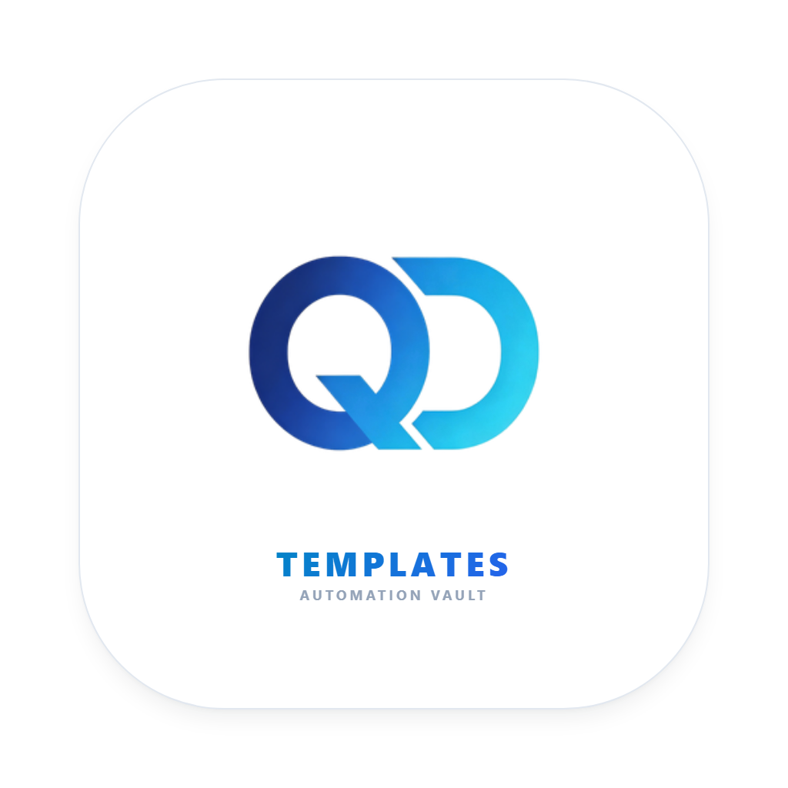

<p align="center">
<picture>
  <source media="(prefers-color-scheme: dark)" srcset="brand/qiandao-templates-avatar-dark.png">
  
</picture>
</p>

<h1 align="center">QianDao Templates</h1>
<p align="center"><strong>QianDao 官方精选公共模板仓库</strong> · 社区签到模板每日自动同步与分类整理</p>

<p align="center">
  <a href="https://github.com/co11ector/QianDao-Templates/actions/workflows/sync-upstream.yml"></a>
  
  
  
</p>

> 「QianDao 自动化运行台」**官方精选公共模板仓库**：持续从上游社区仓库 [`qd-today/templates`](https://github.com/qd-today/templates) 每日自动同步、校验并按站点类型分类归纳，供 [QianDao](https://github.com/co11ector/QianDao) 用户开箱即用、一键订阅与定时签到。

### 🌟 核心特性

- ⚡ **开箱可用**：订阅本仓库即可在应用内挑选模板，不必自己收集；
- 🔄 **每日更新**：每天自动比对上游社区变动，24 小时内全自动跟进同步；
- 📂 **整理清楚**：按站点类型分目录，索引与文件一一对应；
- 🛡️ **来源可查**：每个模板的作者与出处都保留在索引里。

仓库与本地目录单独存在只因为两件事：模板必须能被**公开抓取**（主仓是私库，而 GitHub 的可见性是仓库级的），以及让本地文件管理更清楚。

## 模板分类

模板按站点类型分目录摆放，应用内「模板库 → 公共模板」可以直接搜索与订阅：

| 目录 | 分类 | 说明 |
| --- | --- | --- |
| [`pt/`](templates/pt) | PT 站 | 需要登录的私有 PT 站，多为签到与保号类任务 |
| [`forum/`](templates/forum) | 论坛社区 | Discuz、Flarum 等论坛的每日签到与打卡 |
| [`video/`](templates/video) | 影音 | 视频与音乐站点的签到、试听与日常任务 |
| [`signin/`](templates/signin) | 通用签到 | 其余站点；未命中上面关键词的都归到这里 |

完整列表见 [`tpls_history.json`](tpls_history.json)：索引里 `filename` 为相对路径，`url` 指向本仓库，应用按 `<仓库地址>/<filename>` 抓取。

其中 **24 个是本项目自有的模板**（放在 `local/` 下，每日同步不会覆盖）：

| 模板 | 位置 |
| --- | --- |
| HDSky天空论坛每日签到 | [`templates/pt/hdsky-daily-signin.har`](templates/pt/hdsky-daily-signin.har) |
| PTShare每日签到 | [`templates/pt/ptshare-daily-signin.har`](templates/pt/ptshare-daily-signin.har) |
| 3DM论坛每日登录奖励 | [`templates/forum/3dm-daily-login-reward.har`](templates/forum/3dm-daily-login-reward.har) |
| 吾爱破解每日签到奖励 | [`templates/forum/52pojie-daily-signin.har`](templates/forum/52pojie-daily-signin.har) |
| Anime字幕论坛每日签到 | [`templates/forum/acgrip-daily-signin.har`](templates/forum/acgrip-daily-signin.har) |
| 游侠论坛每日签到 | [`templates/forum/ali213-daily-signin.har`](templates/forum/ali213-daily-signin.har) |
| Chiphell每日登录访问 | [`templates/forum/chiphell-daily-login.har`](templates/forum/chiphell-daily-login.har) |
| 飞牛私有云论坛 | [`templates/forum/fnnas-forum-daily-signin.har`](templates/forum/fnnas-forum-daily-signin.har) |
| 火绒安全论坛 | [`templates/forum/huorong-forum-daily-login.har`](templates/forum/huorong-forum-daily-login.har) |
| IT天空每日签到 | [`templates/forum/itsk-daily-signin.har`](templates/forum/itsk-daily-signin.har) |
| 梦幻天堂·龙网每日登录奖励 | [`templates/forum/lwgod.har`](templates/forum/lwgod.har) |
| 远景论坛 | [`templates/forum/pcbeta-daily-login.har`](templates/forum/pcbeta-daily-login.har) |
| 恩山无线论坛 | [`templates/forum/right-forum-daily-signin.har`](templates/forum/right-forum-daily-signin.har) |
| SSDForum每日签到 | [`templates/forum/ssdforum-daily-signin.har`](templates/forum/ssdforum-daily-signin.har) |
| B站每日综合签到 | [`templates/video/bilibili-daily-suite.har`](templates/video/bilibili-daily-suite.har) |
| 高清影视之家每日登录奖励 | [`templates/signin/10001-daily-login.har`](templates/signin/10001-daily-login.har) |
| BookmarkMars每日登录访问 | [`templates/signin/bookmarkmars-daily-login.har`](templates/signin/bookmarkmars-daily-login.har) |
| 港知堂每日签到 | [`templates/signin/gangzhitang-daily-signin.har`](templates/signin/gangzhitang-daily-signin.har) |
| 高清鸭每日签到 | [`templates/signin/hdduck-daily-signin.har`](templates/signin/hdduck-daily-signin.har) |
| IT之家 | [`templates/signin/ithome.har`](templates/signin/ithome.har) |
| 酷友社每日登录 | [`templates/signin/koolcenter-daily-login.har`](templates/signin/koolcenter-daily-login.har) |
| 三宫六院每日登录 | [`templates/signin/sglynp-daily-login.har`](templates/signin/sglynp-daily-login.har) |
| 什么值得买每日登录 | [`templates/signin/smzdm-daily-signin.har`](templates/signin/smzdm-daily-signin.har) |
| 影迷乐园每日签到 | [`templates/signin/ymlyhd-daily-signin.har`](templates/signin/ymlyhd-daily-signin.har) |

## 自动同步

`.github/workflows/sync-upstream.yml` 每天 **03:17 UTC（北京时间 11:17）** 自动执行，也可以手动触发：

1. 先跑整理脚本的测试 —— **不通过就中止**，不会发布被改坏的索引；
2. 浅克隆上游仓库；
3. 自动清理抓包里的 Cookie、硬编码 UA、静态凭据 Header 与 Cookie 元数据，并拒绝请求 URL/请求体中的字面凭据；
4. 为每个外部 HTTP(S) 请求补齐一份 `User-Agent: {{user_agent}}`；`Cookie: {{cookie}}` 只注入同一站点范围，第三方辅助请求不带站点 Cookie；
5. 拒绝 `browser://`、第三方打码服务和内置 OCR 验证码绕过；
6. 发布前硬门禁要求至少 375 个模板，且索引内容必须与 HAR 文件逐字一致；
7. 重新生成 README 与 CATEGORIES，有变化才提交推送。

全程使用仓库内置的 `GITHUB_TOKEN`，**不需要个人访问令牌**。

## 在 QianDao 中使用

应用内「模板库 → 公共模板」**默认已订阅本仓库**，打开即可搜索与订阅。
若要手动添加，在「已注册仓库」里按下面的值填写：

```
仓库名     default（随意，用于在列表里区分）
仓库地址   https://github.com/co11ector/QianDao-Templates
分支       master
```

添加后点一次「**强制更新**」即可拉到最新模板。本仓库每天自动同步上游，所以之后刷新模板列表取到的就是最新内容，不必反复手动更新。

## 许可与来源

本仓库的内容分属**三种不同的授权范围**，请分别看待：

| 内容 | 来源 | 授权 |
| --- | --- | --- |
| `templates/` 模板数据、`tpls_history.json` 索引 | 上游 [qd-today/templates](https://github.com/qd-today/templates) | 上游**未声明许可证** |
| `tools/`、`tests/`、`.github/`、`docs/` | 本项目（[QianDao](https://github.com/co11ector/QianDao)） | MIT License，Copyright © 2021 QD-Today、2026 co11ector |
| `brand/` 品牌资产 | 本项目（[QianDao](https://github.com/co11ector/QianDao)） | 同上（MIT） |

### 学习用途

上游 README 注明「项目中的模板均为开源模板，仅供学习参考使用，请勿用于商业用途」。本仓库按同样口径提供，**仅供个人学习参考，请勿商用**。

### 作者与出处

每个模板的 `author`、`comments`、`commenturl` 都保留在 [`tpls_history.json`](tpls_history.json) 里，**权利归原作者所有**。本仓库只做同步、校验与整理，不对模板数据主张任何权利。

### 请求移除

如果某个模板侵犯了你的权利、违反所在站点的规则，或你作为原作者希望移除它，请提 issue 说明，我们会尽快处理。

## 反馈与求模板

- **求模板**：用[模板请求表单](https://github.com/co11ector/QianDao-Templates/issues/new?template=template-request.yml)提交（填站点名称、地址、是否需要登录即可）；也可以直接在[模板请求板](https://github.com/co11ector/QianDao-Templates/issues/1)下面留言。
- **想自己动手**：应用内有 HAR 编辑器，抓包导出 `.har` 后可以向上游社区仓库提 PR，同步后这里也会跟着更新。
- **分类不合适 / 模板已失效 / 其他建议**：同样提 issue 说明即可。
